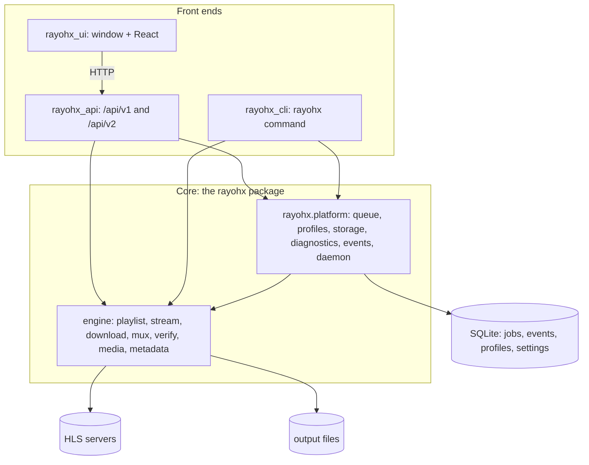

# Architecture

How RayoHX is put together. For day-to-day commands, see [development](development.md); for repository settings, [repository setup](repo-setup.md).

## The pieces



| Piece | Package | Job |
| --- | --- | --- |
| **Engine** | `rayohx` (all but `platform`) | Reads one HLS stream and writes one file: playlist parsing, selection, segment fetching, decryption, remuxing, verification, metadata. Pure library: it never prints, exits or keeps state between downloads. |
| **Platform** | `rayohx.platform` | Everything that must outlive one download: the persistent queue and runner, profiles, storage policy, diagnostics, events, metrics and the daemon. It lives in the core package so the command line and the API share one implementation. |
| **Command line** | `rayohx_cli` | Parses arguments, calls the library, prints results (data on stdout, messages on stderr) and chooses the [exit code](../packages/cli/docs/guides/cli/exit-codes.md). |
| **API** | `rayohx_api` | FastAPI over the library. `/api/v1` keeps its original behavior as a layer over the queue; `/api/v2` exposes the queue, profiles, diagnostics, storage and metrics. |
| **Window** | `rayohx_ui` + `ui/` | A Cornea window hosting a React page that talks to the API. No logic of its own. |

## Rules that keep the layers apart

Checked by `packages/core/tests/unit/test_architecture.py`:

- The engine never imports the platform.
- The platform and the front ends use only public `rayohx.*` modules, never `rayohx._*`.
- The API never imports the window; the command line does not import the API.
- A front end holds no download logic: it calls the platform or the engine.

## One job, end to end

1. A front end calls `queue.add(url, profile=..., overrides=...)`. The platform validates the settings, snapshots the profile into the job, stores secrets (cookies, secret headers) in the secret store and the rest in the database, and emits `queue.job_added`.
2. The **runner** (one per queue, guarded by `runner.lock`, so only one process runs a queue) picks the next job with the pure scheduler (`pick_next`: priority, then rank), checks with the **storage guard** that the disk has room, and starts a `Downloader` on its own thread.
3. The engine announces its working folder (`workspace_opened`), downloads segments, and reports progress. The runner turns engine events into job state and platform events.
4. On success the engine verifies the file (`VERIFYING`), writes metadata and finalizes the output. A file that fails verification is kept as `.invalid` and the job fails with `VERIFICATION_FAILED`.
5. On failure the **retry policy** decides from the error's stable code whether to run again after a growing delay. Every run is recorded in `job_attempts`.
6. Pause is a *hard* pause: the engine stops, keeps its resume state and frees the slot. Stopping the runner (Ctrl-C, SIGTERM) does the same to every running job, and crash recovery requeues jobs that were running when the process died.

## Data and where it lives

| What | Where | Notes |
| --- | --- | --- |
| Jobs, attempts, events, profiles, settings, reports index | SQLite in the data folder (`RAYOHX_HOME` moves everything) | WAL mode; numbered migrations in code; a backup is made before every upgrade; a damaged file is moved aside and rebuilt. |
| Secrets | System credential store (optional `keyring`), else memory | Never in the database, events, logs or reports. |
| Working folders | Next to the output (or the configured workspace) | One per download; owned by a job via `job_workspaces`. |
| Reports | `reports/` in the data folder | Sanitized, mode 0600. |

## Events

Everything notable is a `PlatformEvent` with a category, severity and a payload that has been scrubbed of secrets *before* it is stored. Events go to the database, to subscribers in the same process (the CLI, the daemon's log, tests) and to HTTP clients: `GET /api/v2/events` pages through the log with a cursor, and `/api/v2/events/stream` follows it as server-sent events.

## Storage and diagnostics

The **storage guard** reads free space and the policy thresholds. It admits a job only if the room left after running downloads' remaining needs stays above the pause threshold; below it, running jobs are paused by the queue (and resumed by it), and below the stop threshold they fail with `STORAGE_LOW` and keep their progress. **Diagnostics** turn stable error codes into explanations, probe the network step by step, describe streams, and write reports through a single sanitizer. See [platform](platform.md).

## Running it

| Mode | Command | Notes |
| --- | --- | --- |
| One download | `rayohx download URL` | No queue. |
| A queue in a terminal | `rayohx queue run` | Stops with Ctrl-C. |
| A service | `rayohx daemon` | Health endpoint, JSON logs, clean stop on SIGTERM. [Operations guide](operations.md). |
| API | `python -m rayohx_api` | Runs the queue itself unless another process does. |
| Window | `rayohx-ui` (Windows) | Hosts the React page and the API. |

## Repository and releases

```text
packages/core/src/rayohx/       engine + platform (one wheel: rayohx)
packages/cli/src/rayohx_cli/    command line
packages/api/src/rayohx_api/    HTTP API
packages/ui/src/rayohx_ui/      window; ui/ is the React frontend
packages/docker/                container image
scripts/                        OpenAPI export, benchmark, installer build
```

The version lives in `__version__`; the release workflow compares it with the tag. Checks run in layers: pre-commit hooks locally, `ci.yml` on pull requests (lint, UI checks, unit and integration tests on Python 3.11 to 3.15, Windows UI test, build), then the repository ruleset. [Releasing](releasing.md) covers publishing and the installers; [development](development.md) covers tooling.
