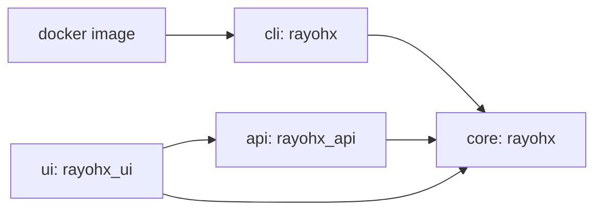

# Architecture

How the repository fits together. Each package documents its own design: [core](../packages/core/docs/architecture.md), [CLI](../packages/cli/docs/architecture.md), [API](../packages/api/docs/architecture.md), [UI](../packages/ui/docs/architecture.md) and [Docker](../packages/docker/docs/architecture.md). For commands, see [development](development.md).

## Packages

- **core** holds all the logic. It raises exceptions instead of printing or exiting, so every front end can reuse it.
- **cli** reads options, calls the library and shows results.
- **api** validates input, calls the library and shapes responses. It runs on its own or is mounted inside the window.
- **ui** wires Cornea Shell to the API and the library. It is Windows only.
- **docker** packages the command line as a container image.

Dependencies point one way: the core library never imports the other packages, and the API and core never import the UI.

## Checks

| Layer | What runs | Where |
| --- | --- | --- |
| Local | secret scan, file hygiene, Ruff, mypy and the lock check | pre-commit hooks |
| Pull request | CI, security scans and dependency review | GitHub Actions |
| Repository | Branch ruleset, secret scanning, Dependabot | GitHub settings |
| Release | Tag and version check, build, trusted publish, installers | `release-<package>.yml` |

## Workflows

Every package has its own workflow for each concern, plus one for the rest of the repository:

| Workflow | Purpose |
| --- | --- |
| `ci-<package>.yml` | lint, type check, tests and build for that package; `ci-repo.yml` covers the shared files |
| `security-<package>.yml` | static analysis and, for Docker, image scanning |
| `audit-<package>.yml` | weekly audit of the locked dependencies |
| `release-<package>.yml` | build, publish and attach the artifacts for that package |

`ci.yml`, `security.yml`, `audit.yml` and `release.yml` are the entry points that call them. `ci` is the single required check in the branch ruleset, and `release.yml` routes a release by its tag. Shared steps live in `.github/actions/`. See [releasing](releasing.md) and [security](security.md).
