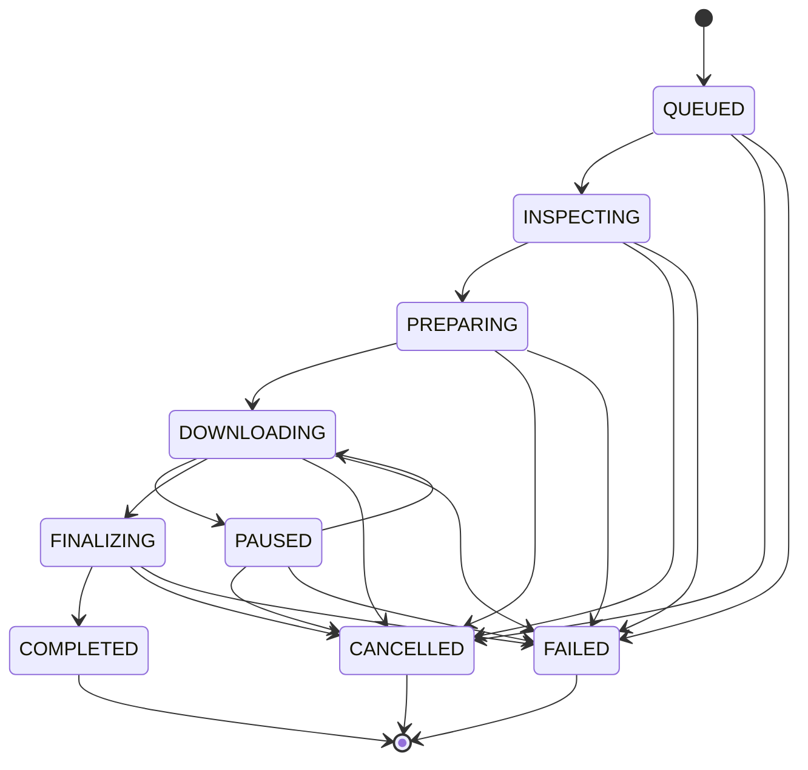

# Python guide

Everything RayoHX does is available as plain Python. The library never prints, never exits the
process and never reads global state: it takes typed settings, returns frozen results and raises
meaningful exceptions. The command line, the API and the desktop window are thin front ends over
the same package.

```python
import rayohx
from rayohx.config import SelectionConfig

playlist = rayohx.inspect("https://cdn.example.com/vod/master.m3u8")

for variant in playlist.variants:
    print(variant.height, variant.bandwidth, variant.uri)

choice = rayohx.select_stream(playlist, SelectionConfig(quality="720p", audio_languages=("en",)))
print(choice.variant.uri)
print([track.name for track in choice.audio_tracks])
print(choice.notes)  # why a wish could not be met, if any
```

> **What exists today.** This guide covers the engine parts that are built: looking at a stream
> without downloading it (`inspect`), parsing playlists, choosing tracks, settings, events,
> cancellation, errors and logging. The download controller, the segment scheduler, storage and
> the output stage arrive in later phases and are added to this guide when they ship. The
> settings and events they will use already exist and are described below.

## Installation

RayoHX needs Python 3.11 or newer. Add it to a project with [uv](https://docs.astral.sh/uv/):

```bash
uv add RayoHX
```

or with pip:

```bash
pip install RayoHX
```

The package name is `RayoHX`, the import name is `rayohx`. Requests are made with `httpx`, and the
library does not need FFmpeg to inspect streams.

```python
import rayohx

print(rayohx.__version__)  # 0.1.0
```

## What is public

Names without a leading underscore are the public API. Anything starting with an underscore
(`rayohx._http`, `rayohx._ratelimit`, `rayohx._redaction`, `rayohx._logs`) is internal and can
change in any release.

The top-level package loads its names the first time you use them, so `import rayohx` stays fast
and a front end loads only the parts it needs.

| Import from | What you find there |
|---|---|
| `rayohx` | `inspect`, `inspect_playlist`, `parse_playlist`, `is_hls_playlist`, `select_stream`, `configure_logging`, `CancellationToken`, the playlist and result models, and the enums |
| `rayohx.config` | `DownloadConfig`, `NetworkConfig`, `ProxyConfig`, `OutputConfig`, `StorageConfig`, `SelectionConfig`, `validate_url` |
| `rayohx.errors` | The `RayoHXError` hierarchy |
| `rayohx.events` | `EventBus`, `DownloadEvent`, `DownloadStateMachine`, `TRANSITIONS` |
| `rayohx.models` | Frozen dataclasses for playlists, tracks, segments, requests, progress and results |
| `rayohx.enums` | Download and segment states, event types, container, encryption, storage and output choices |

Errors and settings classes are imported from their own modules, not from the top-level package:

```python
from rayohx.config import NetworkConfig
from rayohx.errors import PlaylistNotFoundError
```

## Functions

| Function | Purpose |
|---|---|
| `rayohx.inspect(url, network=None)` | Fetch and parse the playlist at a URL; returns a `MasterPlaylist` or `MediaPlaylist` |
| `rayohx.inspect_playlist(url, fetcher)` | The same, with a fetcher you supply instead of the built-in HTTP layer |
| `rayohx.parse_playlist(text, uri)` | Parse playlist text you already have; returns a `MasterPlaylist` or `MediaPlaylist` |
| `rayohx.is_hls_playlist(text)` | `True` if the text starts with `#EXTM3U` |
| `rayohx.select_stream(master, config)` | Choose the video, audio and subtitle tracks; returns a `StreamSelection` |
| `rayohx.configure_logging(level=INFO, *, console=True, log_file=None)` | Turn on logging for the `rayohx` logger |

URLs must be absolute `http` or `https` addresses. Anything else raises `ConfigurationError`.

### inspect

```python
rayohx.inspect(url: str, network: NetworkConfig | None = None) -> Playlist
```

Looks at a stream without downloading any media. It fetches the playlist, follows redirects,
parses it and returns the typed result. Use `network` to set headers, cookies, a proxy, timeouts,
retries and TLS for the request.

```python
from rayohx.config import NetworkConfig

network = NetworkConfig(
    headers={"Referer": "https://site.example/", "Authorization": "Bearer ..."},
    cookies={"session": "..."},
    connect_timeout=5,
    retries=2,
)
playlist = rayohx.inspect("https://cdn.example.com/vod/master.m3u8", network)
```

The result is a `MasterPlaylist` when the address lists several streams, and a `MediaPlaylist` when
it lists segments:

```python
from rayohx.models import MasterPlaylist

if isinstance(playlist, MasterPlaylist):
    print(len(playlist.variants), "streams")
else:
    print(playlist.segment_count, "segments,", playlist.total_duration, "seconds")
```

Possible errors:

| Error | When |
|---|---|
| `ConfigurationError` | The URL is not an absolute http(s) address, or a setting is invalid |
| `PlaylistNotFoundError` | The server answers 404 or 410 |
| `AuthenticationError` | The server answers 401 or 403 |
| `InvalidPlaylistError` | The response is not an HLS playlist, for example a web page |
| `UnsupportedPlaylistError` | The playlist uses a feature RayoHX refuses (see below) |
| `NetworkError` and its subclasses | Connection, timeout, TLS, redirect or bad-response failures |

### parse_playlist

```python
rayohx.parse_playlist(text: str, uri: str) -> Playlist
```

Parses playlist text and makes every address absolute against `uri`, using RFC 3986 rules. Pass
the address the text actually came from, after redirects, so relative addresses resolve correctly.

```python
text = open("master.m3u8", encoding="utf-8").read()
playlist = rayohx.parse_playlist(text, "https://cdn.example.com/vod/master.m3u8")
print(playlist.variants[0].uri)  # https://cdn.example.com/vod/360p/index.m3u8
```

What to know:

- A playlist is recognised by its `#EXTM3U` header, never by its file name or address.
- Tags the parser does not know are skipped, so newer playlists keep working.
- Errors name the line. A web page or other non-playlist raises `InvalidPlaylistError` with a hint
  to check the address, headers and cookies.
- Playlist variables (`EXT-X-DEFINE`) and I-frame-only playlists raise `UnsupportedPlaylistError`,
  because ignoring them would produce wrong addresses or wrong video.
- Segment and playlist addresses must be `http` or `https`. Key addresses may use another scheme
  so a SAMPLE-AES or DRM playlist can still be inspected; the key is marked unsupported and a
  download refuses it later.
- A key without an `IV` keeps `iv=None`; the IV is derived from the segment's `sequence_number`
  when decrypting, as the HLS specification says.
- A byte range without an offset continues from the previous range of the same file.
- The container (`MPEG_TS`, `FMP4`, `WEBVTT`) is guessed from the playlist and stays `UNKNOWN`
  when it is unclear.

### inspect_playlist

```python
rayohx.inspect_playlist(url: str, fetcher: PlaylistFetcher) -> Playlist
```

`inspect` with your own transport. A fetcher is any object with a `fetch_text(url)` method that
returns the playlist text and the address it finally came from (after redirects). This is useful
when requests must go through an existing session, a cache or a test double.

```python
class CachedFetcher:
    def __init__(self, texts: dict[str, str]) -> None:
        self.texts = texts

    def fetch_text(self, url: str) -> tuple[str, str]:
        return self.texts[url], url


fetcher = CachedFetcher({"https://cdn.example.com/vod/360p/index.m3u8": media_text})
playlist = rayohx.inspect_playlist("https://cdn.example.com/vod/360p/index.m3u8", fetcher)
```

### select_stream

```python
rayohx.select_stream(master: MasterPlaylist, config: SelectionConfig) -> StreamSelection
```

A pure function: the same playlist and settings always give the same answer. When a wish cannot be
met it picks the closest track and records why in `notes`; it does not raise.

```python
from rayohx.config import SelectionConfig

choice = rayohx.select_stream(
    master,
    SelectionConfig(
        quality="720p",
        audio_languages=("de", "fr"),
        subtitle_languages=("en",),
    ),
)
print(choice.variant.height)                    # 720
print([a.name for a in choice.audio_tracks])    # ['Deutsch']
print([s.name for s in choice.subtitle_tracks]) # ['English']
print(choice.notes)                             # ("No audio track is available in 'fr'.",)
```

`StreamSelection` has `variant`, `audio_tracks`, `subtitle_tracks` and `notes`.

| Setting | Behavior |
|---|---|
| `quality="best"` | Largest picture, then bandwidth, average bandwidth, frame rate and codec support. Equal streams: the first listed. |
| `quality="worst"` | The smallest picture, then the lowest bandwidth. |
| `quality="1080p"` | The best stream at or below that size. If every stream is larger, the smallest one. |
| `quality="auto"` | Like `1080p`: sharp without the cost of the largest stream. |
| `max_resolution`, `max_bitrate` | Limits applied before the quality choice. If nothing fits, the smallest stream is used. A stream that does not state its size is never ruled out by a size limit. |
| `audio_languages`, `audio_names` | One track per entry, in the order given. If none is found, the default audio track is used. `en` matches `en-US`, but `en-US` does not match `en-GB`. |
| `subtitle_languages`, `subtitle_names` | Subtitles are off by default. A missing language selects nothing and adds a note. |

Picture size is the shorter side, so a 720x1280 portrait stream counts as 720p. Audio-only streams
are skipped when video streams exist. Forced tracks are chosen only when nothing else matches or
when asked for by name.

### configure_logging

See [Logging](#logging).

## Settings

Settings are frozen dataclasses with keyword-only fields. Each one checks itself when it is
created and raises `ConfigurationError` with a message and a hint, so a bad value fails early:

```python
from rayohx.config import SelectionConfig
from rayohx.errors import ConfigurationError

try:
    SelectionConfig(quality="ultra")
except ConfigurationError as exc:
    print(exc.describe())
    # quality 'ultra' is not valid. Use best, worst, auto, or a height such as 1080p.
```

Collections are stored as tuples and read-only mappings, so a settings object cannot change after
it is built. Use `dataclasses.replace(config, retries=5)` to make a changed copy.

### DownloadConfig

The top-level settings object; it groups the others.

| Field | Default | Meaning |
|---|---|---|
| `concurrency` | `4` | Segments fetched at the same time, from 1 up to a built-in maximum |
| `resume` | `True` | Continue an interrupted download |
| `network` | `NetworkConfig()` | Requests: headers, timeouts, retries, TLS, proxy |
| `storage` | `StorageConfig()` | Where and how data is kept while downloading |
| `output` | `OutputConfig()` | The finished file |
| `selection` | `SelectionConfig()` | Which tracks to take |

```python
from rayohx.config import DownloadConfig, NetworkConfig, SelectionConfig

config = DownloadConfig(
    concurrency=8,
    network=NetworkConfig(retries=5, rate_limit=2_000_000),
    selection=SelectionConfig(quality="1080p", audio_languages=("en",)),
)
```

### NetworkConfig

| Field | Default | Meaning |
|---|---|---|
| `headers` | `{}` | Extra request headers. Yours win over the default `User-Agent`. |
| `cookies` | `{}` | Cookies sent to trusted hosts only |
| `user_agent` | `"RayoHX"` | The `User-Agent` header |
| `connect_timeout` | `10.0` | Seconds to open a connection |
| `read_timeout` | `30.0` | Seconds to wait for data |
| `total_timeout` | `None` | Cap on one call, retries included; `None` means no cap |
| `retries` | `3` | Extra attempts after a retryable failure |
| `backoff_factor` | `0.5` | Wait between retries grows as `backoff_factor * 2^n` with a little random spread |
| `max_redirects` | `10` | Redirects followed per request |
| `verify_tls` | `True` | `True` verifies with the default trust store, `False` turns verification off, a `Path` verifies against that CA bundle |
| `proxy` | `None` | A `ProxyConfig` |
| `rate_limit` | `None` | Download speed cap in bytes per second, shared by all workers |
| `credential_hosts` | `()` | Extra hosts, besides the one the download starts from, allowed to receive secret headers and cookies |

Retries cover connection failures, timeouts, HTTP 408, 425, 429 and 5xx, a web page served as
media, an empty body and a body cut short. `Retry-After` is obeyed up to 60 seconds. Other 4xx
answers, a refused certificate and an expired overall limit are not retried.

**Credentials stay with their host.** Secret headers (`Authorization`, `Cookie`, API keys, anything
with token or secret in its name) and the configured cookies go to the host the download started
from and to `credential_hosts`. A redirect or a segment on another host gets `Referer`, `Origin`,
`User-Agent` and other plain headers, but none of the secrets.

```python
network = NetworkConfig(
    headers={"Authorization": "Bearer ...", "Referer": "https://site.example/"},
    credential_hosts=("keys.example.com",),  # may also receive the Authorization header
)
```

Environment variables such as `HTTPS_PROXY` are not read. Settings come only from the
configuration, so behaviour never depends on hidden state.

### ProxyConfig

| Field | Default | Meaning |
|---|---|---|
| `url` | required | The proxy address, `http` or `https` |
| `username`, `password` | `None` | Sent as proxy authentication |

```python
from rayohx.config import NetworkConfig, ProxyConfig

network = NetworkConfig(proxy=ProxyConfig(url="http://proxy.example:3128", username="me", password="..."))
```

### SelectionConfig

| Field | Default | Meaning |
|---|---|---|
| `quality` | `"best"` | `best`, `worst`, `auto`, or a height such as `720p` |
| `max_resolution` | `None` | Largest picture size to consider, such as `1080p` |
| `max_bitrate` | `None` | Largest bandwidth in bits per second |
| `audio_languages` | `()` | Language codes, in order of preference |
| `audio_names` | `()` | Track names, in order of preference |
| `subtitle_languages` | `()` | Subtitle language codes |
| `subtitle_names` | `()` | Subtitle track names |

### OutputConfig

| Field | Default | Meaning |
|---|---|---|
| `path` | `None` | Path of the output file; it must not be empty |
| `format` | `OutputFormat.AUTO` | `AUTO`, `TS`, `MP4` or `SEGMENTS` |
| `overwrite` | `False` | Replace an existing file. Off by default so a download never destroys data silently |
| `validate` | `True` | Check the finished file |
| `remux_backend` | `RemuxBackend.AUTO` | `AUTO`, `NATIVE` or `FFMPEG` |
| `ffmpeg_path` | `None` | Path of an FFmpeg program to use when the backend is `FFMPEG`, or when `AUTO` needs it |

RayoHX does its own container handling and never bundles FFmpeg. It remuxes and never transcodes.
An FFmpeg already installed on the machine is used only for streams the native muxer cannot
handle. See the [engine design](../engine.md#output-without-ffmpeg).

### StorageConfig

| Field | Default | Meaning |
|---|---|---|
| `strategy` | `StorageStrategy.AUTO` | `AUTO`, `DIRECT`, `STREAMING`, `BUFFERED`, `TEMPORARY` or `HYBRID` |
| `workspace_dir` | `None` | Folder for working files; `None` lets the engine pick a folder beside the output |
| `buffer_bytes` | `67108864` | Memory the bounded buffer may hold (64 MiB) |
| `max_temp_bytes` | `None` | Most temporary data allowed on disk at once; `None` means no explicit limit |
| `reserve_bytes` | `268435456` | Free space that must remain after the download (256 MiB) |
| `keep_state_on_failure` | `True` | Keep resume state after a failure or cancellation |

### Secrets stay out of logs

Headers, cookies and proxy passwords are left out of `repr`, and `as_dict()` hides them, so the
result is safe to log or store. `DownloadRequest` and `ProxyConfig` show addresses with their
credentials and query tokens removed.

```python
network = NetworkConfig(
    headers={"Authorization": "Bearer abc", "Referer": "https://s"},
    cookies={"sid": "123"},
)
print(network)
# NetworkConfig(user_agent='RayoHX', connect_timeout=10.0, ... credential_hosts=())
print(network.as_dict()["headers"])  # {'Authorization': '***', 'Referer': 'https://s'}
print(network.as_dict()["cookies"])  # {'sid': '***'}

from rayohx.models import DownloadRequest

request = DownloadRequest(url="https://cdn.example.com/master.m3u8?token=abc", config=config)
print(request.url)  # https://cdn.example.com/master.m3u8?token=***
```

## Playlists and models

Everything the library returns is a frozen dataclass. Nothing is changed in place.

`inspect` and `parse_playlist` return a `Playlist`, which is either of:

**`MasterPlaylist`**: `uri`, `variants`, `video_tracks`, `audio_tracks`, `subtitle_tracks`,
`version`. Helpers: `audio_group(group_id)` and `subtitle_group(group_id)` return the tracks that
belong to a stream's group.

**`MediaPlaylist`**: `uri`, `segments`, `target_duration`, `media_sequence`, `end_list`, `version`,
`playlist_type`, `container`. Helpers: `segment_count`, `total_duration` (seconds) and `is_vod`.

| Model | Fields |
|---|---|
| `Variant` | `uri`, `bandwidth`, `average_bandwidth`, `resolution`, `codecs`, `frame_rate`, `video_range`, `video_group`, `audio_group`, `subtitle_group`, `name`; property `height` |
| `Resolution` | `width`, `height`; property `pixels` |
| `AudioTrack` | `group_id`, `name`, `language`, `uri`, `default`, `autoselect`, `forced`, `channels`, `characteristics` |
| `SubtitleTrack` | `group_id`, `name`, `language`, `uri`, `default`, `autoselect`, `forced`, `characteristics` |
| `VideoTrack` | `group_id`, `name`, `uri`, `default`, `autoselect` |
| `Segment` | `index`, `uri`, `duration`, `sequence_number`, `byte_range`, `init_map`, `encryption`, `discontinuity`, `program_date_time`, `title` |
| `SegmentRange` | `length`, `offset`; method `http_header()` |
| `InitMap` | `uri`, `byte_range` |
| `EncryptionInfo` | `method`, `uri`, `iv`, `key_format`, `key_format_versions` |
| `StreamSelection` | `variant`, `audio_tracks`, `subtitle_tracks`, `notes` |

A track whose `uri` is `None` has its audio inside the video segments.

```python
master = rayohx.parse_playlist(text, "https://cdn.example.com/vod/master.m3u8")

for variant in sorted(master.variants, key=lambda v: v.bandwidth, reverse=True):
    size = f"{variant.resolution.width}x{variant.resolution.height}" if variant.resolution else "?"
    print(f"{size:>10}  {variant.bandwidth / 1_000_000:.1f} Mbit/s  {variant.uri}")
```

Models that describe a download (`DownloadRequest`, `DownloadProgress`, `DownloadResult`,
`OutputInfo`, `StorageMetrics`) are used by the controller and its events:

| Model | Fields |
|---|---|
| `DownloadRequest` | `url`, `config` |
| `DownloadProgress` | `state`, `downloaded_bytes`, `written_bytes`, `total_bytes`, `completed_segments`, `total_segments`, `speed`, `average_speed`, `eta_seconds`, `active_workers`, `storage` |
| `DownloadResult` | `download_id`, `url`, `state`, `elapsed_seconds`, `progress`, `output`, `error` |
| `OutputInfo` | `path`, `container`, `size_bytes` |
| `StorageMetrics` | `output_bytes`, `temporary_bytes`, `working_bytes`, `peak_temporary_bytes`, `downloaded_bytes`, `written_bytes` |

## Events and states

The engine reports through events and never prints. An `EventBus` delivers `DownloadEvent`
objects to the listeners you subscribe. A listener that raises is logged and never stops the
download, so a broken progress bar cannot break a transfer.

```python
from rayohx.enums import DownloadState, EventType
from rayohx.events import DownloadEvent, EventBus

bus = EventBus()


def show(event: DownloadEvent) -> None:
    print(event.type.name, event.state.name, event.message or "")


unsubscribe = bus.subscribe(show)  # subscribe returns a function that removes the listener

bus.emit(
    DownloadEvent(type=EventType.DOWNLOAD_STARTED, download_id="d1", state=DownloadState.QUEUED)
)
# DOWNLOAD_STARTED QUEUED

unsubscribe()
```

A `DownloadEvent` has `type`, `download_id`, `state`, `timestamp`, and the optional `progress`,
`segment_index`, `message` and `data`. Events can arrive from worker threads, so keep a listener
quick and thread-safe.

| `EventType` | Meaning |
|---|---|
| `DOWNLOAD_STARTED` | A download was accepted |
| `PLAYLIST_LOADED` | The playlist was fetched and parsed |
| `STREAM_SELECTED` | Tracks were chosen |
| `SEGMENT_STARTED`, `SEGMENT_COMPLETED`, `SEGMENT_FAILED` | One segment's progress (`segment_index`) |
| `DOWNLOAD_PROGRESS` | Periodic totals in `progress` |
| `FINALIZATION_STARTED`, `FINALIZATION_COMPLETED` | Joining or remuxing the output |
| `DOWNLOAD_COMPLETED`, `DOWNLOAD_FAILED`, `DOWNLOAD_CANCELLED` | The download ended |

### States

`DownloadStateMachine` allows only the moves in `rayohx.events.TRANSITIONS`, safely across
threads. `COMPLETED`, `FAILED` and `CANCELLED` are final. A cancelled download ends as
`CANCELLED`, not as a failure.



```python
from rayohx.enums import DownloadState
from rayohx.errors import InvalidStateTransitionError
from rayohx.events import DownloadStateMachine

machine = DownloadStateMachine()  # starts as QUEUED
print(machine.can_move_to(DownloadState.INSPECTING))  # True
machine.move_to(DownloadState.INSPECTING)

try:
    machine.move_to(DownloadState.COMPLETED)
except InvalidStateTransitionError as exc:
    print(exc.describe())  # A download cannot go from inspecting to completed.
```

## Cancellation

`CancellationToken` is a flag that one thread sets and many workers check. It is safe to share
across threads, and it never kills anything: work stops at its next check.

```python
from rayohx import CancellationToken
from rayohx.errors import CancellationError

token = CancellationToken()

token.cancel()              # ask everything holding the token to stop; calling again is harmless
print(token.is_cancelled)   # True
token.raise_if_cancelled()  # raises CancellationError
token.wait(5.0)             # sleep up to 5 s, waking at once if cancelled; True means cancelled
```

Use it in your own loops the same way the engine does:

```python
def work(items, token):
    for item in items:
        token.raise_if_cancelled()
        process(item)
```

The download controller will accept a token and stop waiting, retrying and reading between chunks
as soon as it is set.

## Errors

Every error derives from `RayoHXError`. Each one carries a redacted `message`, an optional `hint`
that says what to do, and `retryable`. `describe()` joins message and hint.

```text
RayoHXError
├── ConfigurationError           an invalid setting or address
├── PlaylistError
│   ├── InvalidPlaylistError     not an HLS playlist, or a broken one
│   ├── UnsupportedPlaylistError a feature RayoHX refuses (EXT-X-DEFINE, I-frame only)
│   └── PlaylistNotFoundError    HTTP 404 or 410 for a playlist
├── NetworkError
│   ├── NetworkConnectionError
│   │   ├── NetworkTimeoutError
│   │   └── TLSError             the certificate check failed
│   ├── InvalidResponseError     web page instead of media, empty, cut short, wrong range
│   └── HTTPError                an HTTP error status; has url, status_code, retry_after
│       └── AuthenticationError  HTTP 401 or 403
├── DownloadError
│   ├── SegmentDownloadError
│   └── InvalidStateTransitionError
├── OutputError
│   ├── InsufficientStorageError
│   ├── OutputExistsError
│   ├── OutputFormatError        no way to produce the requested format
│   └── FinalizationError
└── CancellationError
```

```python
from rayohx.errors import AuthenticationError, PlaylistNotFoundError, RayoHXError

try:
    playlist = rayohx.inspect("https://cdn.example.com/vod/master.m3u8")
except PlaylistNotFoundError as exc:
    print(exc.describe())  # The playlist was not found: ... Check the address; the link may have expired.
except AuthenticationError as exc:
    print("Refused with HTTP", exc.status_code)
except RayoHXError as exc:  # anything else the library raises
    print(exc.describe(), "(retry might help)" if exc.retryable else "")
```

`HTTPError` adds `url`, `status_code` and `retry_after` (seconds, or `None`). Messages never contain
credentials: addresses are redacted, so it is safe to log or show `exc.message`.

```python
from rayohx.errors import HTTPError

error = HTTPError("https://x/y?token=secret", 503, retry_after=2.0)
print(error.describe())   # HTTP 503 for https://x/y?token=***
print(error.retryable)    # True
```

## Logging

The library writes only to loggers under the name `rayohx` and adds no handlers of its own, so it
stays silent until your application asks for logs. `configure_logging` is the shortcut:

```python
import rayohx

rayohx.configure_logging("DEBUG")                    # to stderr
rayohx.configure_logging("INFO", log_file="rayohx.log")
rayohx.configure_logging("INFO", console=False, log_file="rayohx.log")  # file only
```

Logs go to stderr, never stdout, so they cannot mix with output you pipe. Every record is redacted
(URLs, tokens, cookies and `Authorization` values are hidden) and tagged with the download id.

If you prefer to manage logging yourself, use the standard library:

```python
import logging

logging.getLogger("rayohx").addHandler(logging.StreamHandler())
logging.getLogger("rayohx").setLevel(logging.INFO)
```

## Threading and safety

- Settings, models and results are immutable, so they can be shared between threads freely.
- `EventBus`, `DownloadStateMachine` and `CancellationToken` are safe to use from several threads.
- Events and cancellation checks may run on worker threads. Do UI work or other thread-bound work
  by handing the event to the right thread, for example through a queue.
- The HTTP layer is internal. It reuses connections and respects the settings in `NetworkConfig`;
  you reach it through `rayohx.inspect`.

## Examples

Pick the best stream under a data budget, preferring English audio with German as a fallback:

```python
import rayohx
from rayohx.config import SelectionConfig

master = rayohx.inspect("https://cdn.example.com/vod/master.m3u8")
choice = rayohx.select_stream(
    master,
    SelectionConfig(max_bitrate=3_000_000, audio_languages=("en", "de")),
)
print(choice.variant.uri, choice.variant.bandwidth)
for note in choice.notes:
    print("note:", note)
```

Get the length of a video-on-demand stream:

```python
playlist = rayohx.inspect("https://cdn.example.com/vod/360p/index.m3u8")
if not isinstance(playlist, rayohx.models.MasterPlaylist) and playlist.is_vod:
    minutes, seconds = divmod(int(playlist.total_duration), 60)
    print(f"{playlist.segment_count} segments, {minutes}:{seconds:02d}")
```

Inspect a stream behind a login, with a timeout and a proxy, without leaking secrets to other hosts:

```python
from rayohx.config import NetworkConfig, ProxyConfig

network = NetworkConfig(
    headers={"Authorization": "Bearer ...", "Referer": "https://site.example/"},
    cookies={"session": "..."},
    proxy=ProxyConfig(url="http://proxy.example:3128"),
    total_timeout=30,
    retries=2,
)
playlist = rayohx.inspect("https://cdn.example.com/vod/master.m3u8", network)
```

Check whether text is a playlist before parsing it:

```python
text = response_body.decode("utf-8", errors="replace")
if rayohx.is_hls_playlist(text):
    playlist = rayohx.parse_playlist(text, final_url)
else:
    print("Not an HLS playlist")
```

Test code that uses RayoHX without a network, by supplying a fetcher:

```python
class FakeFetcher:
    def fetch_text(self, url: str) -> tuple[str, str]:
        return MASTER_TEXT, url


def test_lists_variants() -> None:
    playlist = rayohx.inspect_playlist("https://cdn.example.com/master.m3u8", FakeFetcher())
    assert len(playlist.variants) == 3
```

Show a settings object in a log line without leaking anything:

```python
import json
import logging

logging.getLogger("myapp").info("network settings: %s", json.dumps(network.as_dict()))
```

## Not yet available

These parts of the engine are planned and are not in the library yet: the download controller and
the call that runs a download from start to finish, the segment scheduler, workspace and storage
handling, decryption, and the output and muxing stage. `DownloadConfig`, `OutputConfig`,
`StorageConfig`, `DownloadRequest`, `DownloadProgress`, `DownloadResult` and the events already
exist so code written against them today keeps working. See the
[engine design](../engine.md) for the full picture.
