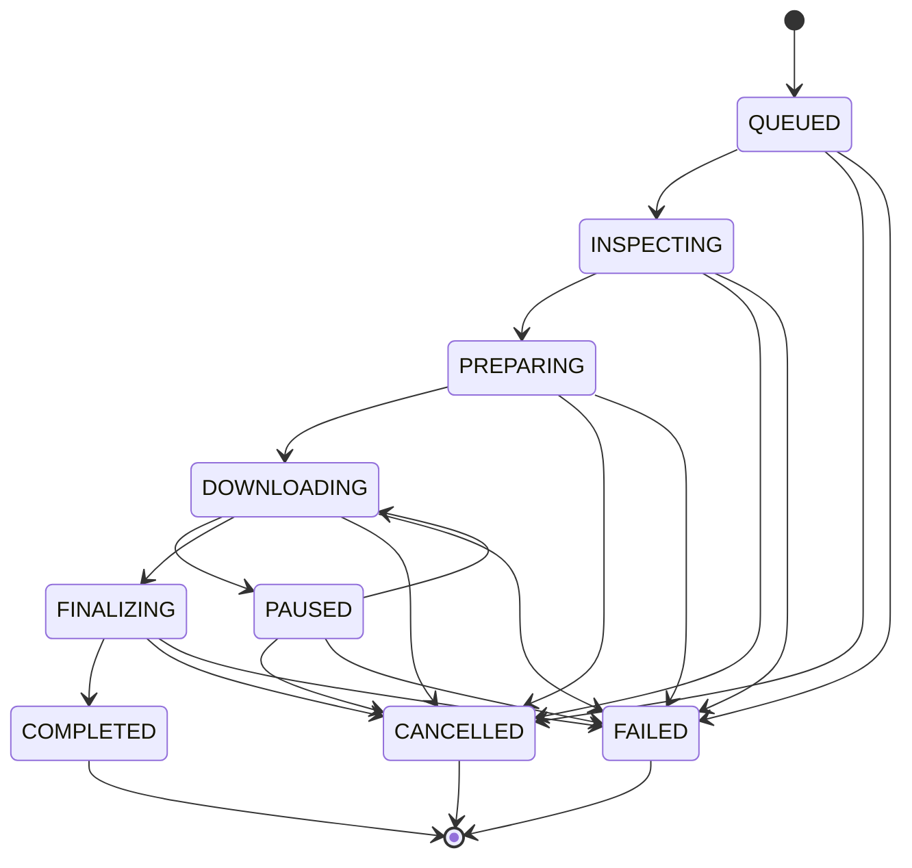

# Events and cancellation

The engine reports through events and never prints. An `EventBus` delivers `DownloadEvent` objects
to the listeners you subscribe, a `DownloadStateMachine` keeps the life cycle valid, and a
`CancellationToken` lets one thread ask the work of many to stop.

[Back to the Python guide](../python.md)

| Name | Module | Purpose |
|---|---|---|
| [`EventBus`](#eventbus) | `rayohx.events` | Delivers events to listeners |
| [`DownloadEvent`](#downloadevent) | `rayohx.events` | Something that happened |
| [`EventListener`](#eventbus) | `rayohx.events` | Type alias: `Callable[[DownloadEvent], None]` |
| [`DownloadStateMachine`](#downloadstatemachine) | `rayohx.events` | Allows only valid state changes |
| [`TRANSITIONS`](#states) | `rayohx.events` | The allowed moves |
| [`CancellationToken`](#cancellationtoken) | `rayohx` | Cooperative cancellation |

## EventBus

Delivers events to listeners. A listener that raises is logged and never stops the download, so a
broken progress bar cannot break a transfer. Listeners may run on worker threads, so keep them quick
and thread-safe.

| Method | Returns |
|---|---|
| `subscribe(listener)` | A function that removes the listener again |
| `emit(event)` | `None`; delivers `event` to every listener, in the order they subscribed |

```python
from rayohx.enums import DownloadState, EventType
from rayohx.events import DownloadEvent, EventBus

bus = EventBus()


def show(event: DownloadEvent) -> None:
    print(event.type.name, event.state.name, event.message or "")


unsubscribe = bus.subscribe(show)

bus.emit(
    DownloadEvent(type=EventType.DOWNLOAD_STARTED, download_id="d1", state=DownloadState.QUEUED)
)
# DOWNLOAD_STARTED QUEUED

unsubscribe()  # later events are no longer delivered to `show`
```

A listener that raises does not affect the others:

```python
bus.subscribe(lambda event: 1 / 0)  # logged, then ignored
bus.subscribe(show)  # still called
```

## DownloadEvent

Something that happened during a download. A frozen dataclass with keyword-only fields.

| Field | Type | Default | Meaning |
|---|---|---|---|
| `type` | `EventType` | required | What happened |
| `download_id` | `str` | required | The identifier shared by log lines and results |
| `state` | `DownloadState` | required | The download's state when it happened |
| `timestamp` | `float` | now | Seconds since the epoch |
| `progress` | `DownloadProgress \| None` | `None` | Totals, on progress events |
| `segment_index` | `int \| None` | `None` | The segment, on segment events |
| `message` | `str \| None` | `None` | A short description, if any |
| `data` | `Mapping[str, Any]` | `{}` | Extra details |

### EventType reference

`Downloader` and `download()` emit every type. See [Downloading](downloading.md#events-during-a-download)
for the order.

| `EventType` | When | Fields filled |
|---|---|---|
| `DOWNLOAD_STARTED` | A download was accepted | `message` is the address with secrets removed |
| `PLAYLIST_LOADED` | A playlist was fetched and parsed (twice for a master playlist) | `data["kind"]` is `"master"` or `"media"` |
| `STREAM_SELECTED` | Tracks were chosen | `data`: `bandwidth`, `resolution`, `codecs`, `audio`, `subtitles`, `notes` |
| `SEGMENT_STARTED` | A segment began | `segment_index` |
| `SEGMENT_COMPLETED` | A segment finished | `segment_index`, `data["bytes"]`; `message` says "Reused from earlier run." when a resumed download already had it |
| `SEGMENT_FAILED` | A segment could not be downloaded | `segment_index`, `message` |
| `DOWNLOAD_PROGRESS` | Periodic totals | `progress` |
| `FINALIZATION_STARTED` | Joining and validating began | `progress` |
| `FINALIZATION_COMPLETED` | The output was validated and put in place | `message` is the output path |
| `DOWNLOAD_COMPLETED` | The download succeeded | `message` is the output path, `progress` |
| `DOWNLOAD_FAILED` | The download failed | `message`, `progress`, `data["hint"]` |
| `DOWNLOAD_CANCELLED` | The download was cancelled | `message`, `progress`, `data["hint"]` |

The `PREPARING` state has no event of its own; it is visible through `Downloader.state` and the
`state` field of the next events.

## States

`DownloadStateMachine` allows only the moves in `rayohx.events.TRANSITIONS`, a mapping from each
`DownloadState` to the set of states it may move to. `COMPLETED`, `FAILED` and `CANCELLED` are final.
A cancelled download ends as `CANCELLED`, not as a failure.

| From | May move to |
|---|---|
| `QUEUED` | `INSPECTING`, `FAILED`, `CANCELLED` |
| `INSPECTING` | `PREPARING`, `FAILED`, `CANCELLED` |
| `PREPARING` | `DOWNLOADING`, `FAILED`, `CANCELLED` |
| `DOWNLOADING` | `PAUSED`, `FINALIZING`, `FAILED`, `CANCELLED` |
| `PAUSED` | `DOWNLOADING`, `FAILED`, `CANCELLED` |
| `FINALIZING` | `COMPLETED`, `FAILED`, `CANCELLED` |
| `COMPLETED`, `FAILED`, `CANCELLED` | nothing |



## DownloadStateMachine

Holds the state of one download and allows only valid moves. Safe across threads.

```python
DownloadStateMachine(state: DownloadState = DownloadState.QUEUED)
```

| Member | Returns |
|---|---|
| `state` (property) | The current `DownloadState` |
| `can_move_to(new_state)` | Whether `new_state` is reachable from the current state |
| `move_to(new_state)` | The state it left; raises `InvalidStateTransitionError` if the move is not allowed |

```python
from rayohx.enums import DownloadState
from rayohx.errors import InvalidStateTransitionError
from rayohx.events import DownloadStateMachine

machine = DownloadStateMachine()  # starts as QUEUED
print(machine.can_move_to(DownloadState.INSPECTING))  # True
print(machine.move_to(DownloadState.INSPECTING))  # DownloadState.QUEUED, the state it left

try:
    machine.move_to(DownloadState.COMPLETED)
except InvalidStateTransitionError as exc:
    print(exc.describe())  # A download cannot go from inspecting to completed.
```

## CancellationToken

A flag that one thread sets and many workers check. It is safe to share across threads and it never
kills anything: work stops at its next check. Calling `cancel()` again does nothing.

| Member | Returns |
|---|---|
| `cancel()` | `None`; asks everything holding the token to stop |
| `is_cancelled` (property) | Whether cancellation has been requested |
| `raise_if_cancelled()` | `None`; raises `CancellationError` if cancellation has been requested |
| `wait(timeout)` | `bool`; sleeps up to `timeout` seconds, waking at once if cancelled. `True` means cancelled |

```python
from rayohx import CancellationToken
from rayohx.errors import CancellationError

token = CancellationToken()

token.cancel()
print(token.is_cancelled)  # True

try:
    token.raise_if_cancelled()
except CancellationError as exc:
    print(exc.describe())  # The download was cancelled.

print(token.wait(5.0))  # True, immediately, because it is already cancelled
```

Use it in your own loops the same way the engine does:

```python
def work(items, token):
    for item in items:
        token.raise_if_cancelled()
        process(item)
```

Sleep without blocking cancellation:

```python
if token.wait(30):
    return  # cancelled while waiting
```

Cancel from another thread, for example a signal handler or a button:

```python
import threading

worker = threading.Thread(target=work, args=(items, token))
worker.start()
...
token.cancel()
worker.join()
```

Pass a token to `download(cancel=token)` or `Downloader(cancel=token)`. The download stops waiting,
retrying and reading between chunks as soon as the token is set, and returns a result in the
`CANCELLED` state (see [Downloading](downloading.md#downloader)). What was downloaded so far is kept
so the next run can continue.

## Examples

Collect events into a list, for a test:

```python
events: list[DownloadEvent] = []
bus.subscribe(events.append)
```

A progress line that updates in place:

```python
def progress_line(event: DownloadEvent) -> None:
    if event.type is EventType.DOWNLOAD_PROGRESS and event.progress is not None:
        p = event.progress
        print(
            f"\r{p.fraction:6.1%}  {p.speed / 1e6:5.1f} MB/s  {p.completed_segments}/{p.total_segments}",
            end="",
        )


bus.subscribe(progress_line)
```

Hand events to a UI thread through a queue:

```python
import queue

inbox: queue.Queue[DownloadEvent] = queue.Queue()
bus.subscribe(inbox.put)
# in the UI loop: event = inbox.get_nowait()
```
