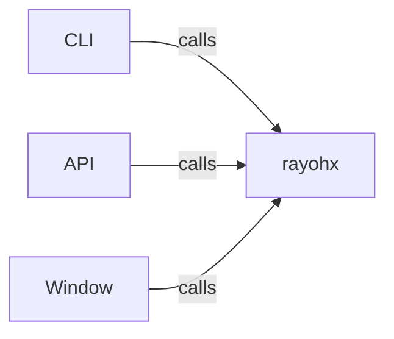

# Core architecture

How the `rayohx` package (the download engine) is put together. For using it, see the [Python guide](guides/python.md).

## Layering

The package is a library. It takes typed settings, returns frozen results and raises meaningful exceptions. It never prints, never exits the process and never reads global state. The command line, the API and the window are front ends over this one package, and the package never imports any of them.

It has two runtime dependencies: `httpx` for every network request and `cryptography` for AES-128 segment decryption. Everything else, including the MPEG-TS and MP4 remuxer, is written in the package.

Names without a leading underscore are public; the ones re-exported from `rayohx/__init__.py` (listed in `__all__`) are the supported surface. Modules and packages that start with `_` are internal and may change at any time. Public packages load their submodules lazily on first use, so `import rayohx` stays cheap.



## Modules

```text
packages/core/src/rayohx/
  __init__.py      the public names: inspect, select_stream, download, Downloader and the models
  config/          typed, validated settings: network, storage, output, selection, proxy, and DownloadConfig that groups them
  models/          frozen data: playlists, tracks, segments, requests, progress and results
  enums.py         DownloadState, EventType, StorageStrategy, OutputFormat, RemuxBackend and the other enums
  errors.py        every exception the engine raises, each with a message and a hint
  cancellation.py  CancellationToken: ask work to stop, and let it stop cleanly
  events/          the download state machine and the event bus
  playlist/        reading HLS playlists (RFC 8216) and inspecting a stream before downloading it
  stream/          choosing a variant and its audio and subtitle tracks
  downloader/      Downloader (the controller), the download() shortcut and the ways output is delivered
  serialization.py plain-data views of playlists, selections, progress and results
  logs.py          configure_logging for applications

  _http/           HttpClient: every network request goes through it
  _crypto/         AES-128 decryption and key retrieval
  _download/       the engine that downloads, stores and checks segments
  _mux/            the built-in remuxer, and the optional use of an installed FFmpeg
  _ratelimit.py    a speed limit shared by all workers
  _redaction.py    removes secrets from URLs, headers and text before they are logged or shown
  _logs.py         the logger namespace, the download id tag and the redaction filter
```

## Looking at a stream

`inspect` fetches a playlist through `HttpClient` and returns a `MasterPlaylist` (a list of variants and their tracks) or a `MediaPlaylist` (a list of segments). `playlist/parser.py` reads the text into the frozen models in `models/playlist` and `models/segment`; an invalid playlist raises `InvalidPlaylistError` with the line it failed on. `select_stream` then picks a variant and its audio and subtitle tracks from a `SelectionConfig`, and reports in `notes` why a wish could not be met. Neither step downloads any media.

## A download, step by step

1. `download()` is a shortcut that builds a `DownloadRequest` and a `DownloadConfig` and runs a `Downloader`. `Downloader.run()` can also be used directly, with `cancel()` and `events` for control and progress.
2. The settings and the address are validated first. A bad value raises `ConfigurationError` before any request is made.
3. **Inspecting.** The playlists are read and the stream is chosen, as above. Separate audio tracks and subtitles become extra jobs beside the main video.
4. **Preparing.** `_download/_output` decides the output name and format, `_download/_storage` estimates the space needed and checks the disk has it, and `_download/_workspace` opens the working folder.
5. **Downloading.** `_download/_media.py` downloads one media playlist with the segment pipeline (see below).
6. **Finalizing.** The finished output is checked against the format the playlist promised, then moved into place.
7. The result is a frozen `DownloadResult`. A failure raises an error, and a stop raises `CancellationError`.

The controller moves through the states `queued`, `inspecting`, `preparing`, `downloading` (or `paused`) and `finalizing`, and ends in `completed`, `failed` or `cancelled`. Each change is published as an event.

## The segment pipeline

Workers fetch, decrypt and store; one thread takes segments out of the store in playlist order and hands them to the output sink. Because only one thread writes, sinks need no locking. New work starts only while the storage strategy allows it, which is what keeps memory and disk use bounded.

- **Fetching** (`_fetcher.py`) turns a playlist entry into decrypted bytes: it requests the segment (or its byte range), fetches the key, and decrypts. Playlists whose encryption cannot be undone are refused up front rather than failing part-way.
- **Storage strategy** (`_storage`) decides where finished segments wait for their turn. `auto` writes straight to a resumable file when the output is one, and streams otherwise. With `direct` and `streaming`, workers may run at most twice the worker count ahead of the segment being written. `StorageMetrics` reports what is held in memory and on disk.
- **Sinks** (`_sinks.py`) are where the ordered segments go: a file, a caller's stream, or a folder of one file per segment. All share one protocol: `preflight`, `open`, `write`, `checkpoint`, `commit` and `abort`.
- **Containers** (`_containers`) recognise a segment's format from its first bytes and check each segment, and the finished file, against what the playlist promised, so damaged media is caught instead of saved.
- **Progress** (`_progress.py`) turns the counts into speed, ETA and the other numbers a display needs.

## Output

A download becomes an output file in one of three ways (`downloader/_delivery.py`):

- **Plain.** The segments are joined as they are (MPEG-TS into `.ts`, fragmented MP4 into `.mp4`), or saved one file each.
- **Native remux.** The built-in remuxer in `_mux` re-wraps the stream into a fragmented MP4, joining in any separate audio tracks. It demuxes MPEG-TS, parses H.264, HEVC, AAC, AC-3/E-AC-3 and MP3, and writes the fragments.
- **FFmpeg.** For codecs the built-in remuxer cannot copy, an FFmpeg that is already installed copies the pieces into an MP4. It is never required, bundled or asked to transcode. `RemuxBackend` chooses between the two.

Subtitles are written next to the output as `.vtt` files.

## Resuming

Each download has its own working folder, named from a hash of the download (the address without its query string, so signed links still match) and never from user input, so a hostile address cannot point it elsewhere. It holds the resume state (`state.json`), staged segments and a lock. The state is saved safely, so an interrupted download continues where it stopped, and the lock keeps two runs from sharing a folder.

## Events and cancellation

`Downloader.events` is an `EventBus`. Listeners receive a `DownloadEvent` for each `EventType`: started, playlist loaded, stream selected, segment started, completed or failed, progress, finalization, and the three endings. A listener can be any callable, which is how front ends draw progress.

Cancellation is cooperative. `Downloader.cancel()` (or a `CancellationToken` passed in) asks the workers to stop; they finish or drop what they are doing and the download ends cleanly with the partial work kept for a later resume.

Pausing uses the same token. `Downloader.pause()` stops new segments from starting while the ones already running finish, and `resume()` lets the download go on. The state becomes `paused` and back to `downloading`, with `download_paused` and `download_resumed` events. Cancelling a paused download wakes it and stops it.

## HTTP and security

- Every request goes through `HttpClient` (`_http`), which applies the timeouts, retries, TLS, proxy and rate limit from `NetworkConfig`, and rejects bad responses.
- `_redaction` removes secrets (tokens in URLs, sensitive headers, keys in text) before anything is logged, shown in an error or stored in the settings' text form.
- Settings and models are frozen after they are built, so they can be shared between threads.

## Tests

The tests live in `packages/core/tests`: `unit/` runs by default, and `integration/` holds slower end-to-end tests marked `integration`, which are skipped by default and in pre-commit and run in CI. Coverage must stay at 80% or more.

## Packaging

The package is built with Hatchling. The version lives in one place, `__version__` in `rayohx/__init__.py`, and Hatchling reads it at build time. The release workflow compares it with the release tag. The wheel and sdist of this package go to PyPI; the command line ships in its own package. For the repository-wide checks and the release flow, see the [root architecture](../../../docs/architecture.md).

## Errors

Every error derives from `RayoHXError` and carries a message and a hint. The main ones are `ConfigurationError`, `InvalidPlaylistError`, `DownloadError`, `OutputFormatError`, `UnsupportedCodecError` and `CancellationError`. Front ends show the message and the hint; they never need to parse text.
