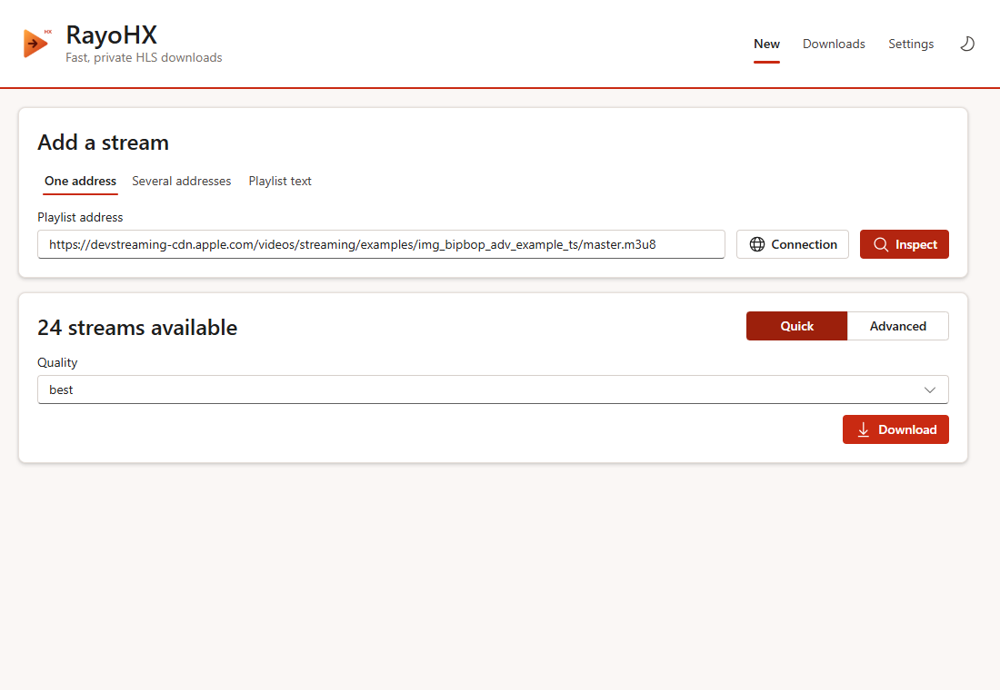

# Window guide

`rayohxu` is the RayoHX desktop window for Windows. It is a front end over the same engine as the
[command line](../../../cli/docs/guides/cli.md) and the [Python package](../../../core/docs/guides/python.md):
the window only shows your choices and results, and all the work is done by the `rayohx` library.



## Install

The window is installed with the Windows setup, `rayohxu-<version>-setup.exe`, from the
[releases page](https://github.com/coldsofttech/RayoHX/releases). It needs Windows 10 or 11 and the
Microsoft Edge WebView2 runtime, which both already include. It is not published on PyPI.

*Placeholder:* install steps with screenshots, silent install and uninstall, and upgrading.

## Open the window

Start RayoHX from the Start Menu or the desktop shortcut, or from a terminal:

```text
rayohxu
rayohxu --no-window    # serve the interface for a browser instead of a window
```

## The screens

The bar at the top has three pages and a theme switch. The sun and moon button changes between the light
and dark themes, and your choice is remembered.

| Page | What it is for | Guide |
|---|---|---|
| **New** | Add one stream, several, or pasted playlist text; pick a quality or the exact stream | [Add a stream](ui/add-a-stream.md) |
| **Downloads** | Follow, pause, stop and retry downloads, and read what the engine reported | [Downloads](ui/downloads.md) |
| **Settings** | Download folder, default options, clean-up and version | [Settings](ui/settings.md) |

## Keeping secrets safe

Logins and passwords you type for a download are used for that download only. They are never saved with
the default options. The protections that exist today are in [security](../security.md).

*Placeholder:* how the window handles headers, cookies and tokens in more detail.

## Troubleshooting

*Placeholder:* the window does not open (WebView2), the installer is blocked by Windows, and where to
find logs.
